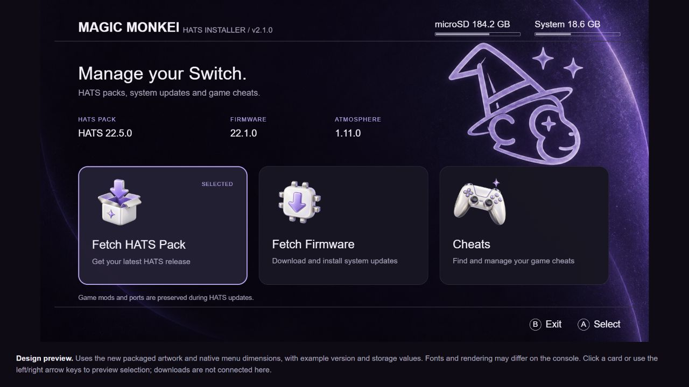

# MM HATS INSTALLER v2.1.6

  

Custom HATS installer for Magic Monkei.

v2.1.6 repairs the outdated installer payload responsible for `0x668 / Module 104`. Both NSP and NRO now carry the current payload and artwork, compare their SD-card copies on every launch, and replace missing or different files. Correct files are not rewritten. Startup removes obsolete files from the installer's own folders, including old themes, duplicate legacy payloads, updater downloads and abandoned update files. The current running NRO, canonical NRO, settings, install receipt, logs, HATS/firmware downloads, cheat database, staging and Hekate recovery backup are preserved. The bundled theme and canonical payload path are selected automatically. HOME-menu themes, bootloader files, other apps and game data are outside this cleanup.

The v1.2.1 payload also prevents incoming HATS packs from overwriting the installer's files. If startup cannot complete repair, HATS installation stays blocked with an SD-card/free-space error. The earlier certificate mounting fix remains in place, with HTTPS certificate and hostname verification enabled.

The refreshed interface uses a dark plum wallpaper with the Magic Monkei mascot, matching pearl-and-lavender icons, larger cards and clear version information. The image above is a layout preview using the shipped artwork and sample values; console rendering still needs hardware verification.

- **Fetch HATS Pack** - Download the latest GitHub release and choose from its available ZIP packs
- **Fetch Firmware** - Download, validate and install firmware, or select an extracted local folder
- **Cheats** - Download, import and manage cheat files for installed games

## Installation

1. **Download MM HATS INSTALLER**: Download the latest `MM-HATS-INSTALLER` zip from the releases page
2. **Extract to SD Card**: Extract the zip file directly to the root of your Nintendo Switch SD card
3. The package includes the installer payload at `/switch/mm-tools/hats-installer.bin`.

The app installs to `/switch/mm-tools/mm-tools.nro` and stores config/cache files under `/config/mm-tools`.

For the NRO edition, extract the **entire ZIP**. The NRO also contains its own v1.2.1 repair payload and artwork, so startup can recover from incomplete older app updates.

The **NSP edition** installs as a full HOME-menu application and includes its compiled program, artwork and installer payload. It checks and repairs its support files on every launch. Update this edition by installing the new NSP; the ZIP self-updater below applies to the NRO edition. See [BUILD_NSP.md](BUILD_NSP.md) for packaging instructions.

The home screen reads the **running** Atmosphere version from the Switch, displaying `AMS x.x.x` and sysMMC/emuMMC. It shows **MAGIC MONKEI BUILD** when the running custom firmware identifies itself as `Magicmonkei.com`. Install the matching updated custom Atmosphere and reboot to enable that identification. Stock, other custom builds and older Magic Monkei builds display the AMS version under **ATMOSPHERE**. SD-card HATS version markers are still used for firmware compatibility information, but do not determine the home-screen build identity.

MM HATS INSTALLER checks `TechRepairs4U/MM-HATS-INSTALLER/releases/latest` when it starts. The release tag and uploaded ZIP filename can be anything: neither semantic version ordering nor a filename prefix is required. GitHub's **Latest** release determines the update. If it has multiple uploaded ZIPs, the user chooses one. Checks happen automatically; installation requires confirmation.

After a successful app update, `/config/mm-tools/installed-app-release.txt` records the GitHub release/asset IDs, upload timestamp, size and digest. The same upload is not offered repeatedly, while a replacement upload or a different Latest release is detected even if the tag or name is reused or the version number decreases. A fresh manual installation without this record may offer the current Latest release once. Drafts and prereleases are excluded by the latest endpoint.

The app validates the NRO, installer payload and four main-menu artwork files before installing them, then offers to restart. Startup verifies all nine support files, including the six icons. ZIP names are unrestricted; the package must still contain the normal `switch/mm-tools` and `config/mm-tools` contents. An older updater that replaces only the NRO is repaired on the next launch of v2.1.6.

## Windows and macOS apps

- [Download HATS Installer for Windows x64](https://github.com/TechRepairs4U/MM-HATS-INSTALLER/releases/download/hats-installer/HATS-Installer-Windows.x64.exe)
- [Download HATS Installer for macOS](https://github.com/TechRepairs4U/MM-HATS-INSTALLER/releases/download/hats-installer/HATS-Installer.dmg)

Boot your Switch into Hekate, then go to **Tools > USB Tools > SD Card** and connect the Switch to your PC or Mac. Run the desktop app; it will show the Switch drive. Choose the HATS version at the top and click **Start**.

The HATS versions explain what they contain. `HATS.mm+fw` includes the HATS pack and the latest firmware (22.5.0); use Daybreak to install the firmware afterward. If you are already on the latest firmware, use `HATS.mm`. The minimalistic version is the stock Atmosphere-style option without Hekate themes or splash screens.

## Features

### Cheats Manager
The cheats manager provides a comprehensive solution for managing game cheats on your Switch:

- **Downloads**: Fetch cheats from nx-cheats-db for the detected game Build ID
- **Local Import**: Import a Build ID `.txt` file, with BOM/comment cleanup and overwrite confirmation
- **View Installed Cheats**: Browse all games with cheats currently installed on your system
- **Cheat Preview**: Preview cheat codes before downloading them
- **Easy Management**: Delete individual cheat files or view detailed cheat information
- **Automatic Detection**: Automatically detects installed games and their build IDs
- **Game Detection**: Improved title-name fallbacks, update-title deduplication and game-card detection
- **Matching and Limits**: Reject ambiguous Build IDs and limit downloaded entries to 128 per file, including existing entries

### Fetch HATS: live latest release

The default source is `https://api.github.com/repos/TechRepairs4U/HATS/releases/latest`.
Fetch HATS uses the release GitHub marks as **Latest**, without comparing version numbers or pinning a tag or filename. Each attached ZIP is listed as a pack choice within the existing tab. Release notes, sizes and download URLs come from that response. GitHub's latest endpoint excludes drafts and prereleases.

Online installs download fresh bytes even if an asset's name or release tag is reused. Interrupted downloads use a `.part` file and are not offered as cached ZIPs. Cached Downloads can reuse a pack ZIP, but an internet connection is required at launch to fetch the current GitHub exclusions. Existing configurations using the old bundled `releases.json` source migrate automatically; custom sources are retained.

### Fetch Firmware

Firmware can be downloaded to `/firmware`, reused from a validated cache, or selected from a local extracted folder with **Y / Local**. Installation uses Atmosphère's Daybreak system-update service and validates the package before asking to install. The confirmation identifies sysMMC or emuMMC, reports FAT32/exFAT support, and warns about downgrades and unverified HATS compatibility. Cancellation is disabled during the actual system-update operation.

### Upstream attribution

The Cheats, Firmware and HATS cache improvements are adapted from [sthetix/HATS-Tools](https://github.com/sthetix/HATS-Tools/tree/a5f3bae), based on Sphaira by ITotalJustice. The firmware service client derives from [Atmosphère/Daybreak](https://github.com/Atmosphere-NX/Atmosphere), by Adubbz and Atmosphère contributors, under GPL-2.0-or-later. MM branding, paths, updater and the three existing main-menu tabs are retained. No Wipe SYSMMC, Game Hub, Network Tools or Component Manager tab is added.

### Automatic Backup
Before installing a HATS pack, the tool can automatically back up Atmosphere core files and HATS sysmodules, `/bootloader`, and recognised utility files in `/switch` to `/sdbackup/` with timestamps (e.g., `/sdbackup/atmosphere_20231225_143000`). Protected game mods, games and ports are excluded. This feature can be toggled in the Advanced Options menu.

### Game, port and mod protection

Immediately after choosing **Launch**, both downloaded and cached HATS installs fetch [TechRepairs4U/HATS/hats-exclusions.json](https://github.com/TechRepairs4U/HATS/blob/main/hats-exclusions.json) from `main`. Edits take effect on the next install without rebuilding the app. The request uses HTTPS certificate verification, a fresh request URL and no cached fallback. If the request fails, is cancelled, or returns an invalid/oversized list, installation stops before backup, Hekate configuration or changes to installed pack files. Keep the console clock accurate for HTTPS verification.

The `schema_version: 1` document supplies `preserve_paths`, an array of SD-relative file or folder paths. Matches ignore ASCII case, accept either slash separator, and include descendants without matching similarly named sibling folders. Excluded paths are skipped during backup, deletion and pack copying, even when the destination does not yet exist. This includes root folders such as `fallout1`, `fallout2`, `Games/Jazz2` and individual files such as `saltysd/exceptions.txt`. Exclusions override recognised utility files and sysmodules. Parents containing excluded files are retained.

Backup and the rebooted payload use one validated snapshot. The payload requires the new complete policy format and consumes the snapshot before installation; retry through the app to fetch a fresh list. The current limits are 1,024 paths, 255 bytes per path, 64 KiB of normalized path data and 256 KiB of JSON. Absolute paths, traversal, control characters and wildcards are rejected. An empty array is valid. A refreshed list replaces previous custom exclusions; the built-in game/mod protections below still apply independently.

All install modes skip existing game/mod title folders under `/atmosphere/contents` during backup, deletion and pack copying. This includes the GTA V port at `/atmosphere/contents/0100B00B51230000`, other game mods and game cheats. Existing protected folders are not traversed or merged with pack files, avoiding large backups and accidental replacement. A title folder that does not yet exist can still be installed from the pack.

HATS sysmodules are updated normally. The bundled manifest's MissionControl, sys-patch, emuiibo, overlay-loader and sys-clk title IDs are recognised even on older packs without a manifest. Additional modules are identified from the installed and incoming `manifest.json`: a title must have both `exefs.nsp` and `flags/boot2.flag` in the same component. Unknown titles stay protected; GTA V is always protected. Unfamiliar modules without this metadata are preserved rather than identified by title-number ranges.

Games and ports under `/switch` are also excluded from backup, deletion and replacement. Only the exact reviewed HATS utility files in `shared/managed_switch_apps.h` can be backed up, removed or updated. A `.nro` extension or an app directory name alone never permits removal: standalone game NROs, port folders, saves, caches and unknown overlays remain untouched, including user files inside a recognised app folder. Unknown utility apps are also kept. New files can still be added when absent. The same rules apply to every install mode and cached installs.

The default mode is **Replace Atmosphere**: old Atmosphere core files and managed sysmodules are removed before the new pack is copied. Existing bootloader and Switch app folders are retained and incoming files update them subject to the protections above. Existing user-selected modes are retained; choose Replace Atmosphere in Advanced Options to limit deletion to Atmosphere. **Replace Atmosphere+Bootloader+HATS Apps** additionally cleans up recognised utility files. Overwrite mode performs no preliminary folder deletion.

Both online installs and Cached Downloads use the same protection and optional backup. Installation refuses an older unprotected payload or staging without an Atmosphere `package3`. Failed preparation/copying keeps staging available for retry.

### Backup Warning
A red warning popup reminds you to backup your SD card before installation. This reminder can be disabled in Advanced Options if you prefer.

### Windows Updater

Make sure to use Hekate for the app so it will copy correctly. Note. " Apps like dbi, awoo or goldleaf cant be used it has to be hekate or SD Card Reader ONLY!!!

For Hekate goto Tools > USB Tools > SD Card and plug your usb from ur computer to ur switch and refresh the app and you should see the drive appear.

